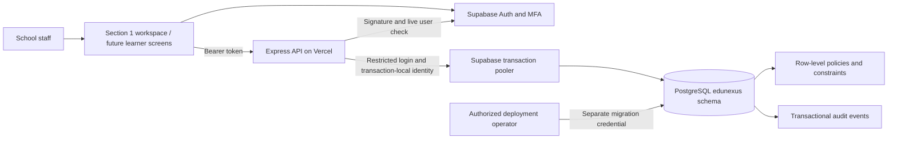
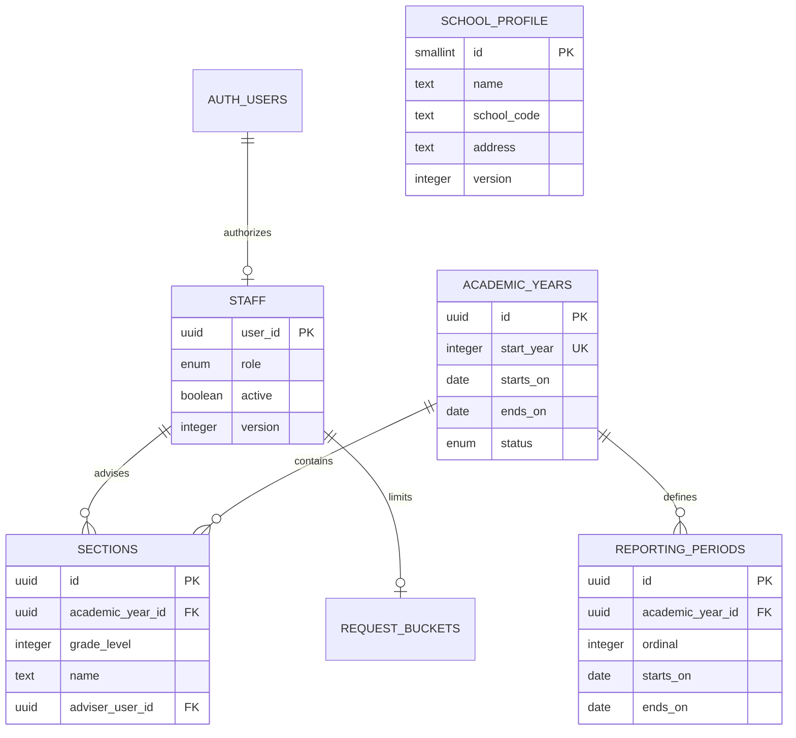

# EDUNEXUS architecture and decisions

EDUNEXUS is a modular TypeScript/Express API with PostgreSQL, Supabase Auth, and Vercel hosting. Modules share one transactional database and an explicit API contract. This fits a single elementary school's scale and allows later frontend work without changing business rules.

## Identity and authorization

Supabase manages passwords, refresh tokens, and MFA. The API accepts ES256/RS256 access tokens issued by the configured project to the authenticated audience. It verifies signatures via the project's JWKS, checks expiry, then checks the user with the Auth service. School roles come from `edunexus.staff`, not user-editable metadata or a role claimed by the frontend. The API reads staff activation on every request. Deployed environments require assurance level `aal2`.

Staff are provisioned in two stages: create a managed identity, then authorize its UUID in the staff registry. The bootstrap script creates the first principal and school profile only when the staff registry is empty. Only principals can manage administrative accounts; principals and administrative officers can manage teachers. This privilege split is an implementation proposal that the school can review.

Tokens are bearer credentials. The future frontend must never put tokens in URLs or logs. Signing out revokes refresh capability according to the Auth provider; an already-issued access token can remain valid until expiry. Use `staff.active=false` for immediate school-level suspension. MFA is mandatory for deployed API access; supervised device enrollment and account recovery need an operational process. [Supabase JWT documentation](https://supabase.com/docs/guides/auth/jwts), [Supabase MFA](https://supabase.com/docs/guides/auth/auth-mfa).

## Database boundary

The `edunexus` schema is private and must not be exposed through the Supabase Data API. `anon`, `authenticated`, and `PUBLIC` receive no access to its records. The Vercel API uses `edunexus_app`, a restricted login with no administrative privileges or role memberships. It does not own the tables and cannot delete records, alter schema, or modify audit events. Every business transaction verifies that it is using this restricted role.

Identity and request IDs are transaction-local PostgreSQL settings. Policies use the active staff row to enforce permissions and teacher section ownership. Fixed, empty-search-path security-definer helpers avoid recursive staff policies. The schema owner is trusted for migrations, bootstrap, and backup; RLS is enabled without forcing it on that owner. No runtime credential is allowed to be the owner. [Supabase RLS](https://supabase.com/docs/guides/database/postgres/row-level-security).

Role checks in RLS protect against missing query filters. They do not make a stolen runtime database credential harmless: the API is a trusted identity boundary and its database login can set transaction context. All user values are parameterized and the runtime secret remains server-only.

## Data model for Section 1

School years begin as drafts. Draft periods must be inside the year and must not overlap; activation requires consecutively numbered, chronologically ordered periods. Only one year may be active. Active years may be closed; closure is final in this section. Year-date correction and reopening require a later explicit business workflow, not a database edit from the frontend.

Sections are unique by school year, grade, and normalized name. Kindergarten is grade `0`. An adviser must be an active teacher. Open-year assignments must be reassigned before that teacher is suspended or changed to an administrative role. The model currently supports one adviser per section, and does not invent subject-teacher access.

## Concurrency and audit

Section 2A adds `learners`, `enrollments`, `enrollment_events`, and `record_access_events`. The full model and effective-date conventions are in [learner registry](learner-registry.md). Annual state is unique by learner/year, references a section in the same year and grade, and changes only through restricted manager-checking database functions. Event rows preserve the state timeline. Teachers lose the relevant learner access on reassignment, withdrawal, staff suspension, or year closure; managers retain history. Successful learner/enrollment API reads append identifiers and request metadata to a protected read log without storing search terms or profile values.

Updates require the previously read integer `version`. SQL includes that version in the update condition; a competing update returns HTTP 409 instead of overwriting another user's change. PostgreSQL constraints enforce uniqueness and relationships even if requests race. Adviser and staff changes share a transaction advisory lock; period changes lock their year row. Transactions have statement and lock timeouts and never include external Auth calls.

Database triggers record writes in the same transaction, with actor, request ID, changed field names, and record ID. Values, learner names, credentials, and document contents are not copied into change-audit rows. Failed/rolled-back changes do not produce successful audit events. Learner read auditing is implemented in Section 2A; document/export auditing remains future work. Logs contain the route template, method, status, duration, and generated request ID; raw URLs, bodies, and tokens are excluded. Audit cursors sort the numeric database ID even though IDs are returned as strings, preserving chronological pagination beyond single-digit IDs.

Rate limiting is persistent per staff user: 180 requests per minute, shared across API instances. The counter commits independently of the business transaction. Invalid-token/anonymous abuse must be handled by provider and edge controls before it reaches this per-user limit.

## Hosting and connections

Section 2B.1 adds `import_previews` and `lrn_corrections`. Pending previews hold input/plan hashes and review metadata. The API rebuilds the plan under the shared roster lock, then creates all rows and a retry receipt in one transaction. A statement-level learner trigger takes that lock before learner row locks, preventing a concurrent insert from evading duplicate revalidation. A year row lock prevents closure during commit. LRN changes require an immutable next-version intent in the same transaction. Direct runtime writes to both new tables are revoked; manager-checking functions and RLS enforce preview ownership and protect correction history. See [registry review](registry-review.md).

Vercel supports an exported Express entry point. The project targets Node 24 and Singapore (`sin1`). PostgreSQL connections use the transaction pooler, certificate-verified TLS, prepared statements disabled, a small local pool, and Vercel's pool lifecycle integration. No request writes files to local disk. Date-only database fields remain `YYYY-MM-DD`; timestamps are serialized as UTC ISO strings. [Express on Vercel](https://vercel.com/docs/frameworks/backend/express), [Node versions](https://vercel.com/docs/functions/runtimes/node-js/node-js-versions), [Supabase connection pooling](https://supabase.com/docs/guides/database/connecting-to-postgres).

SQL migrations have ordered names and checksums. The operator runner serializes migration work with an advisory lock and commits all pending changes transactionally. It refuses a modified already-applied migration. Add a new migration for every deployed schema change. CI tests and builds code; it deliberately does not receive privileged production database credentials or run migrations during Vercel builds.
