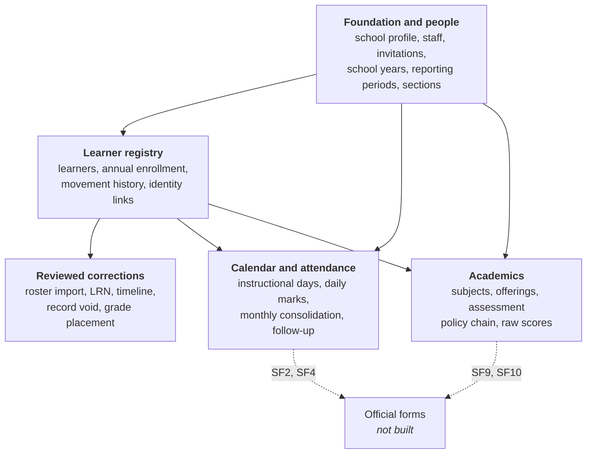
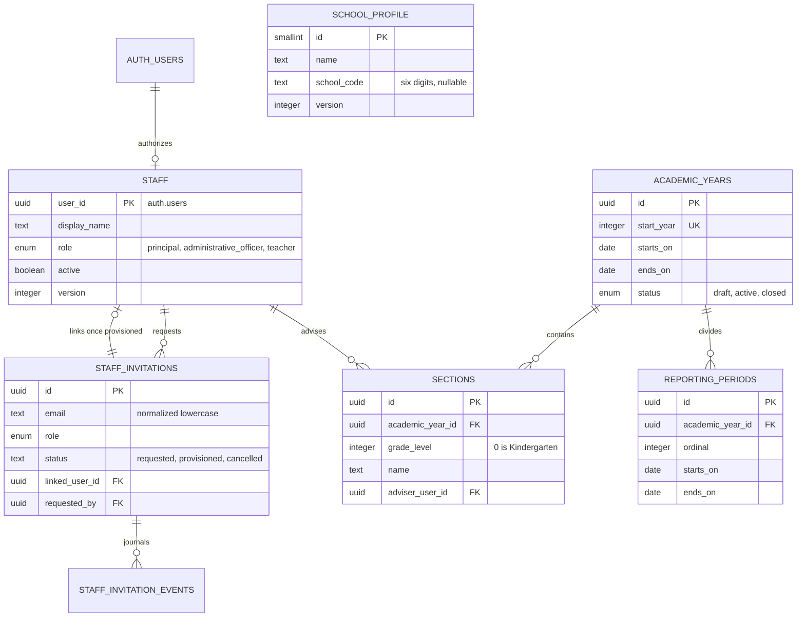
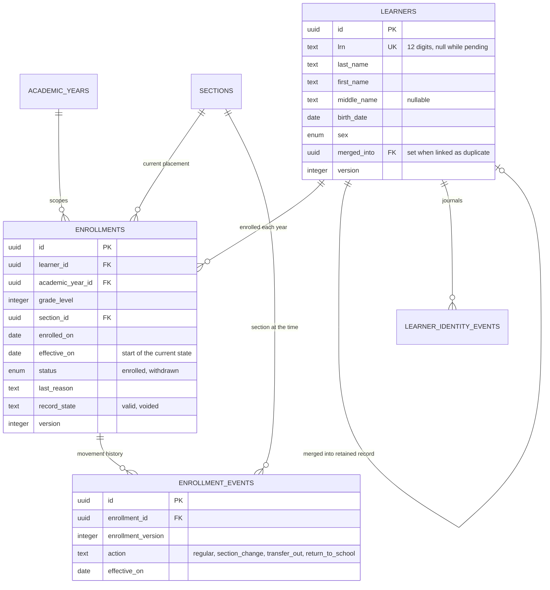
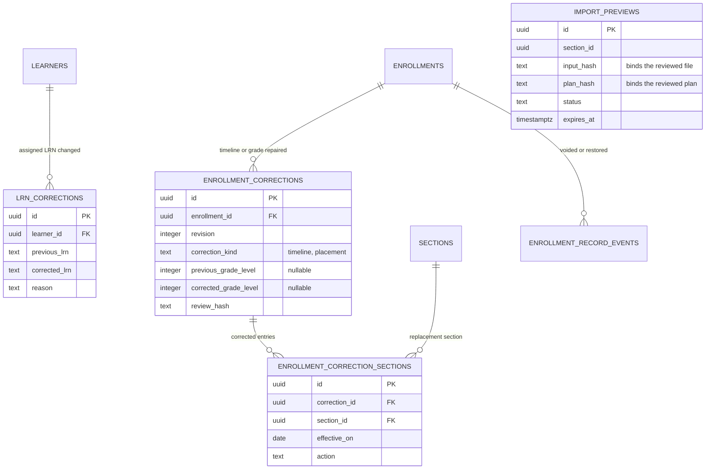
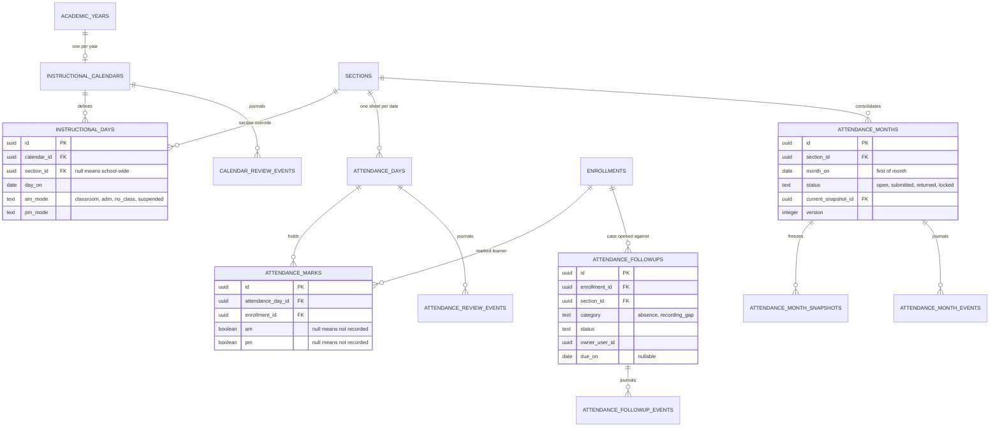
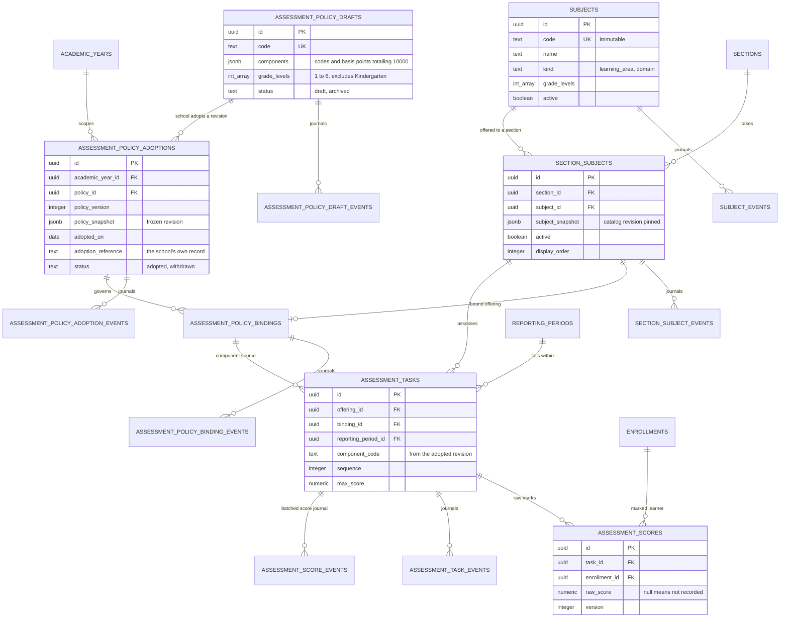

# Entity relationship diagram

Generated from the live `edunexus` schema: 44 tables across 21 migrations. A single diagram at that size is unreadable, so this is an overview followed by one diagram per domain.

For a document rather than a screen, use the rendered figures in [diagrams/](diagrams/): each diagram as SVG and as a double-resolution PNG, with suggested captions.

## How to read these

Two patterns repeat throughout and explain most of the table count.

**Every record that can change has a journal beside it.** A table named `x` usually has a partner named `x_events` holding an immutable before/after snapshot of each change, with the actor, a reason, and the request ID. The journals are written in the same transaction as the change: if the journal cannot be written, the change rolls back. They are shown in the diagrams because they are half the schema, but they always hang off their parent in the same way.

**Every changeable record carries a `version`.** A write supplies the version it last read, and the database refuses the write if that no longer matches. This is what stops two staff overwriting each other silently.

Three tables are global and left out of the domain diagrams to keep them legible:

- `audit_events` — append-only change audit for every table. Records actor, request ID, table, row and the names of changed fields. Never values, learner names or credentials.
- `record_access_events` — append-only log of successful learner and enrollment reads. Records who read which record IDs, never search terms or profile values.
- `request_buckets` — persistent per-staff rate limiting.

Every `*_events` table also references `staff` as the actor. Those edges are omitted from the diagrams; assume them everywhere.

## Overview

Foundation defines the school year, its sections and who may act. The registry places learners into those sections. Attendance and academics both record against an annual enrollment. Corrections sit beside the registry rather than inside it, because a correction never rewrites the original record.

## Foundation and people

Sections are unique by year, grade and normalized name. An adviser must be an active teacher. A composite key of `(id, academic_year_id, grade_level)` lets later tables reference a section and inherit its year and grade, which is how cross-year mistakes are made impossible rather than merely checked.

## Learner registry and enrollment

One learner record persists across school years; the annual enrollment sits underneath it. A partial unique index enforces one **valid** enrollment per learner per year, so a voided record stays as evidence without occupying the slot. `effective_on` is the first day of the new state, not the last day of the old one.

## Reviewed corrections

Corrections are additive. The original `enrollment_events` rows are never rewritten; the effective timeline is the latest correction snapshot plus any ordinary movements recorded after it. Import and correction commits bind a hash of exactly what was reviewed, so a changed file or a stale preview is refused rather than silently applied.

## Calendar and attendance

A date with no calendar row is **unconfigured**, not a school day, and a session with no mark is **unknown**, not present. Both are deliberate: inferring either would corrupt an SF2. Submitting a month freezes an immutable snapshot of who was enrolled and what was marked, and a deferred constraint trigger blocks any later edit that would contradict a frozen month.

## Academics

The chain runs draft → adoption → binding → task → score, and each link protects the one below it: an adopted draft cannot be archived, a bound adoption cannot be withdrawn, and a bound offering cannot be retired, until the thing depending on it is released first. An adoption freezes the whole draft revision, so revising the draft afterwards never changes what the school decided.

**Nothing in this domain computes a grade.** There is no table, column or endpoint for a total, average, percentage, MPS, GWA or transmuted mark. Those wait on the school's grading enclosure, recorded as a gate in [constraints](constraints.md).

## What is not here yet

The schema has no tables for promotion and next-year assignment (Section 5) or for released official forms and their signatories (Section 6). Both are blocked on school decisions rather than on design. When they arrive, promotion will reference `enrollments` across two school years, and released forms will hold immutable snapshots rather than regenerating from live records, for the same reason monthly attendance already does.
